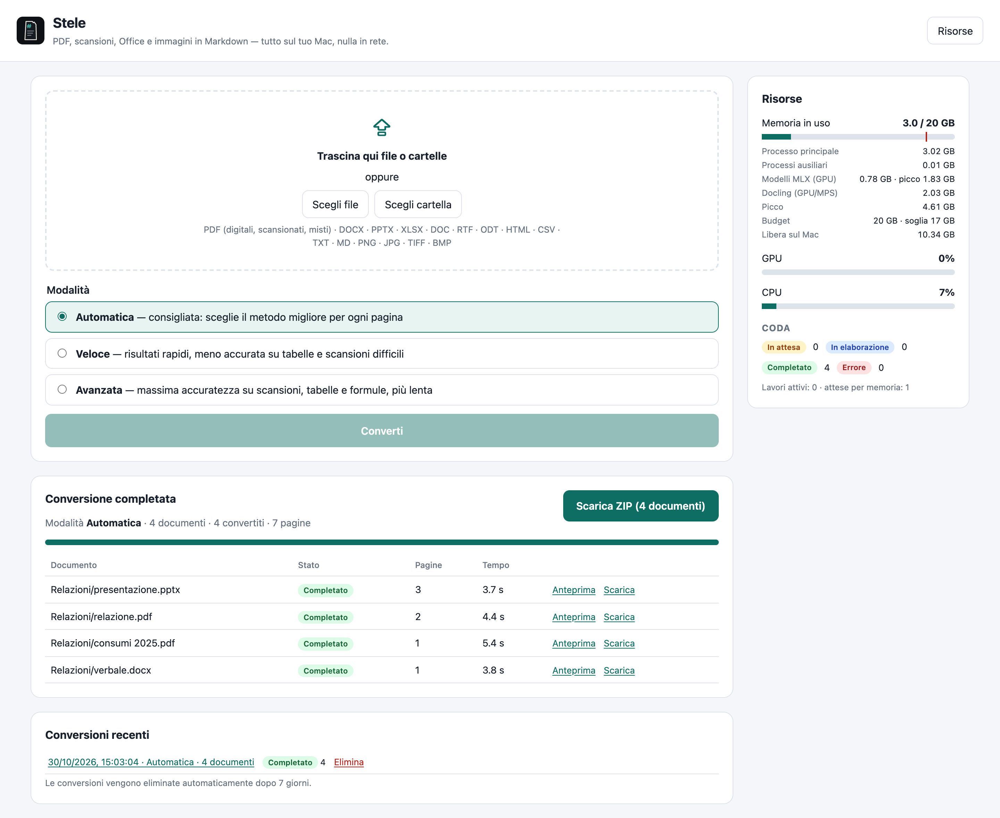
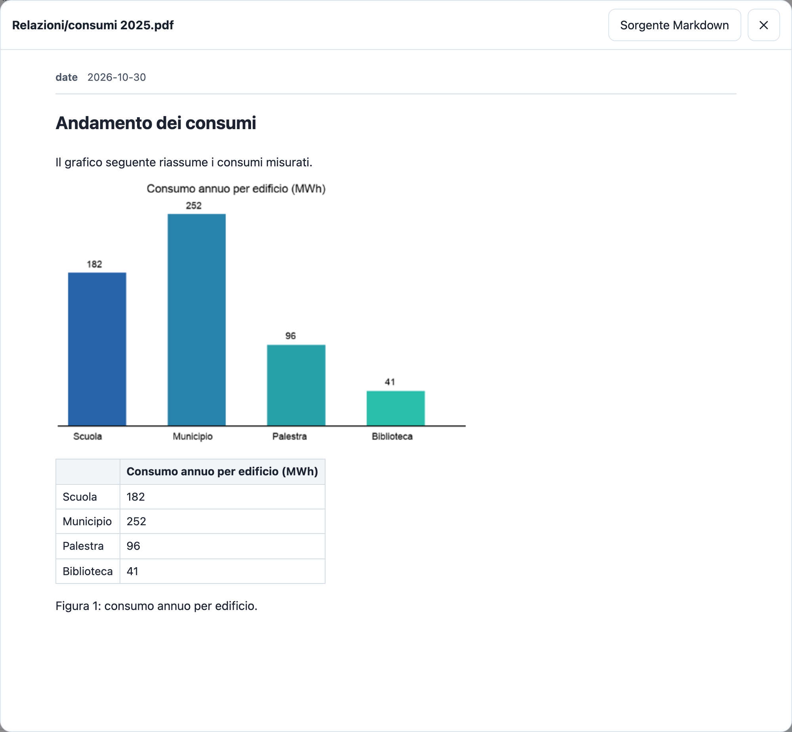
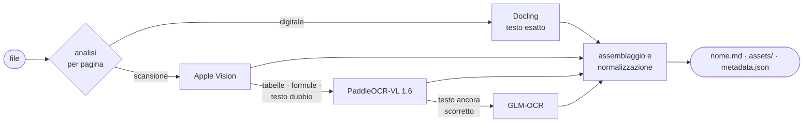

<p align="center">
  
</p>

<p align="center">
  <strong>PDF, scansioni, Office e immagini in Markdown pulito.</strong><br>
  Su Apple Silicon, completamente offline.
</p>

<p align="center">
  
  
  
  
  
</p>

**Stele** converte PDF, scansioni, documenti Office e immagini in un unico documento
Markdown per file, con immagini, tabelle e metadati. Il risultato è pronto per Obsidian,
VS Code o una pipeline RAG.

Ogni pagina viene letta con il motore più adatto: testo esatto per i PDF digitali, Apple
Vision per le scansioni semplici, modelli visione-linguaggio per tabelle, formule e
scansioni difficili. Niente cloud e niente API: il server ascolta solo su `127.0.0.1`,
i modelli si scaricano una volta e l'app lavora offline entro un budget di memoria definito.

<p align="center">
  
</p>
<p align="center"><em>Conversione completata: documenti, anteprime e download ZIP da un'unica schermata.</em></p>

## Indice

- [Caratteristiche](#caratteristiche)
- [Avvio rapido](#avvio-rapido)
- [Modalità](#modalità)
- [Risultato](#risultato)
- [Formati supportati](#formati-supportati)
- [Come funziona](#come-funziona)
- [Motori e modelli](#motori-e-modelli)
- [Memoria e prestazioni](#memoria-e-prestazioni)
- [Dati, privacy e configurazione](#dati-privacy-e-configurazione)
- [Sviluppo](#sviluppo)
- [Limiti noti](#limiti-noti)
- [Risoluzione dei problemi](#risoluzione-dei-problemi)

## Caratteristiche

- **Routing per pagina** — Un PDF misto (pagine digitali, scansioni e tabelle) usa motori
  diversi pagina per pagina e restituisce comunque un documento unico, in ordine e senza
  duplicati.
- **Il modello grande solo quando serve** — Una scansione di prosa da 12 pagine richiede
  **6 s** in modalità automatica contro i 33 s della lettura completa con il modello più
  accurato, a parità di qualità.
- **Nessun contenuto inventato** — I dati di un grafico vengono estratti solo se ogni valore
  è stampato nell'immagine. I metadati compaiono solo se presenti nel file. Il testo non
  viene mai riscritto.
- **Ripresa automatica** — Ogni pagina completata viene salvata subito: dopo un crash la
  conversione riparte dalla prima pagina mancante. Un errore su un file non blocca gli altri.
- **Memoria sotto controllo** — Budget predefinito di 20 GB, rispettato anche con 900 pagine
  in parallelo (picco misurato: 7,7 GB).

## Avvio rapido

**Requisiti:** Mac con Apple Silicon, [uv](https://docs.astral.sh/uv/) e Command Line Tools
di Xcode (`xcode-select --install`).

```bash
git clone <url-del-repository> stele && cd stele
make install   # ambiente Python 3.12, dipendenze bloccate e helper nativo Apple Vision
make models    # download e verifica dei modelli in ./models (~2,6 GB, unico passo online)
make run       # avvia il server, poi apri http://127.0.0.1:8000
```

Trascina file o cartelle nella pagina, scegli la modalità e premi **Converti**. Al termine
puoi scaricare l'intero **ZIP** oppure aprire l'anteprima e scaricare il singolo documento.

<details>
<summary><strong>Nota per Safari</strong></summary>

Safari decomprime automaticamente gli ZIP scaricati: in Download può comparire la cartella
al posto dell'archivio. Per conservare il file `.zip`: Safari → Impostazioni → Generali →
disattiva *Apri i file "sicuri" dopo il download*. Per scegliere ogni volta dove salvarlo:
*Posizione download* → *Chiedi per ogni download*.

</details>

## Modalità

| Modalità | Pagine digitali | Pagine scansionate e immagini | Uso consigliato |
|---|---|---|---|
| **Automatica** *(default)* | Docling | Apple Vision → PaddleOCR-VL per tabelle, formule o testo dubbio → GLM-OCR se il testo resta scorretto | Uso generale |
| **Veloce** | Docling | Apple Vision; Docling + OcrMac solo se la pagina esce vuota. Mai modelli VLM | Molti documenti semplici |
| **Avanzata** | Docling; PaddleOCR-VL per le formule non decodificate | PaddleOCR-VL su tutte le pagine; GLM-OCR se il testo resta scorretto | Scansioni con molte tabelle o formule |

Benchmark sulle stesse 31 pagine di prova (dataset sintetico, MacBook Pro M4 Pro 24 GB):

| Modalità | Tempo | CER medio | Picco memoria |
|---|---:|---:|---:|
| Veloce | 20 s | 2,12% | 2,3 GB |
| **Automatica** | **45 s** | **0,15%** | 5,9 GB |
| Avanzata | 70 s | 0,18% | 5,9 GB |

## Risultato

<p align="center">
  
</p>
<p align="center"><em>Anteprima del documento: grafico originale e tabella dei dati estratti dall'immagine.</em></p>

```text
conversione.zip
├── README.txt                  elenco dei documenti ed eventuali errori
├── relazione/
│   ├── relazione.md            un documento per file sorgente
│   ├── assets/grafico_001.png  immagini collegate con percorsi relativi
│   └── metadata.json           sorgente, formato, pagine, modalità, lingua, durata
└── archivio/scansione/…        le cartelle caricate mantengono la loro struttura
```

- **Markdown uniforme** con qualsiasi motore: titoli senza salti di livello, paragrafi e
  tabelle spezzati tra pagine ricomposti, numeri di pagina e intestazioni ripetute rimossi,
  elenchi, tabelle e formule `$$…$$` in un'unica forma. Titolo, autore e data diventano
  front matter YAML (le "proprietà" di Obsidian) solo se presenti nel file.
- **Tabelle** — Sulle scansioni degradate la struttura viene da PaddleOCR-VL e il testo da
  GLM-OCR, senza perdere né aggiungere numeri. Se la ricostruzione non è sicura, restano
  righe leggibili al posto di una tabella inaffidabile.
- **Grafici** — L'immagine viene sempre conservata; la tabella dei dati compare solo quando
  ogni valore è leggibile nel grafico.
- **Office** — PPTX: una sezione per slide con le note del relatore. XLSX: una sezione per
  foglio, formule con i valori calcolati e celle unite in `metadata.json`.
- **ZIP in streaming** — L'archivio viene generato nella risposta HTTP: nessun file
  intermedio su disco e nessun archivio da ripulire.

## Formati supportati

| Categoria | Formati |
|---|---|
| PDF | Digitali, scansionati, misti, multipagina, con tabelle, formule, grafici o due colonne |
| Office | DOCX, PPTX, XLSX · DOC, RTF, ODT tramite `textutil` di macOS |
| Testo | HTML, CSV, TXT, Markdown |
| Immagini | PNG, JPG, TIFF (anche multipagina), BMP |

> PPT, XLS, ODP e ODS richiedono LibreOffice (`brew install --cask libreoffice`).
> Senza LibreOffice, l'app segnala chiaramente il formato non disponibile.

## Come funziona



Una pagina viene riletta solo se il controllo qualità lo richiede, al massimo una volta
per motore. Il controllo analizza il testo prodotto — dizionario italiano/inglese di macOS,
caratteri spazzatura e cicli di ripetizione tipici dei VLM — invece di fidarsi della
"confidence" dichiarata dai motori: Docling, ad esempio, assegnava 1,0 a una pagina con
il 20% di caratteri sbagliati.

## Motori e modelli

| Motore | Ruolo | Runtime | Disco |
|---|---|---|---:|
| [Docling](https://github.com/docling-project/docling) 2.145 (layout Heron + TableFormer) | PDF digitali, Office, HTML | torch / MPS | 505 MB |
| Apple Vision (`RecognizeDocumentsRequest`, helper Swift) | Scansioni semplici | Neural Engine | di sistema |
| OcrMac (Apple Vision via pyobjc) | Testo nelle immagini dentro Docling | Neural Engine | di sistema |
| [PaddleOCR-VL 1.6](https://huggingface.co/PaddlePaddle/PaddleOCR-VL-1.6) 4-bit + PP-DocLayoutV3 | Tabelle, formule, layout complessi, grafici | [MLX](https://github.com/ml-explore/mlx) / Metal | 936 MB |
| [GLM-OCR](https://huggingface.co/zai-org/GLM-OCR) 4-bit, pagina a 1024 px | Ultima risorsa per pagine difficili | MLX / Metal | 1196 MB |

Le versioni quantizzate sono state scelte dopo una misurazione contro gli originali:
stessa qualità, circa 1 GB in meno e maggiore velocità. Tutti i pesi stanno in `models/`
con revisioni fissate.

```bash
.venv/bin/python -m app.models status           # modelli installati, dimensioni e integrità
.venv/bin/python -m app.models download [key]   # scarica i mancanti (verifica prima lo spazio)
.venv/bin/python -m app.models prune [--yes]    # rimuove i modelli non necessari (default: solo elenco)
```

## Memoria e prestazioni

Ogni motore dichiara il proprio costo misurato e richiede un *lease* prima di lavorare.
Parte solo se il **phys_footprint** reale — che, a differenza dell'RSS, include i buffer
Metal/MLX — più il costo del lavoro resta sotto l'85% del budget e macOS ha memoria libera
sufficiente; altrimenti il lavoro attende in coda. I modelli inattivi vengono scaricati per
liberare spazio e ogni motore mantiene un solo set di pesi: Docling serve fino a 3 lavori
dalla stessa istanza.

| Scenario (budget 20 GB) | Tempo | Picco con processi figli |
|---|---:|---:|
| PDF da 100 pagine | 60 s | 6,2 GB |
| PDF da 500 pagine | 277 s | 6,2 GB |
| 100 + 300 + 500 pagine in parallelo | 305 s | 7,7 GB |

Il pannello **Risorse** mostra memoria del processo e dei processi figli, uso MLX e
Docling, picco, budget, CPU e GPU (dal registro IOKit, senza privilegi). Ciò che non è
misurabile viene indicato come "Non disponibile", mai stimato.

## Dati, privacy e configurazione

Nulla viene scritto nella cartella del progetto. I dati si trovano in
`~/Library/Application Support/Stele` (oppure nella cartella indicata da `STELE_STORAGE`):

| Cartella | Contenuto |
|---|---|
| `uploads/` | File originali caricati |
| `work/` | Checkpoint per pagina e report interni (mai inclusi nello ZIP) |
| `results/` | Documenti finali |
| `jobs.sqlite3` | Stato dei lavori |

Ogni pagina completata viene salvata con scrittura atomica. Le conversioni più vecchie
di 7 giorni vengono eliminate automaticamente, mai mentre sono in corso o in download.

| Variabile | Default | Descrizione |
|---|---|---|
| `STELE_MEMORY_BUDGET_GB` | `20` | Tetto di memoria dell'intera app |
| `STELE_WORKERS` | `4` | File elaborati in parallelo (limite superiore; decide la memoria) |
| `STELE_PORT` | `8000` | Porta del server locale |
| `STELE_STORAGE` | `~/Library/Application Support/Stele` | Cartella dei dati |
| `STELE_RETENTION_DAYS` | `7` | Giorni di conservazione delle conversioni |

## Sviluppo

```text
app/
  main.py          API FastAPI e frontend statico
  jobs.py          lavori su SQLite, scheduler, ripresa, pulizia
  pipeline.py      un file: analisi → routing → motori → qualità → assemblaggio → pubblicazione
  router.py        politica di routing (funzioni pure)
  markdown.py      assemblaggio delle pagine e normalizzazione del Markdown
  tables.py        struttura delle tabelle nel fallback GLM
  charts.py        dati dei grafici, solo se verificabili
  checkpoint.py    checkpoint per pagina, scritture atomiche, lock
  export.py        ZIP in streaming
  resources.py     budget di memoria, lease, residenza dei modelli
  models.py        registro, download, verifica e pulizia dei modelli
  engines/         Docling, Apple Vision, VLM su MLX
native/            helper Swift per Apple Vision
frontend/          HTML, CSS e JS senza dipendenze esterne
benchmarks/        dataset generato, benchmark, REPORT.md
tests/             196 test: unit, router, Markdown, tabelle, grafici, pipeline, API/ZIP,
                   kill -9 e ripresa, browser (Chrome e WebKit)
```

```bash
make test                                          # suite completa
.venv/bin/python -m pytest tests/test_browser.py   # interfaccia in Chrome e WebKit (Playwright)
make bench                                         # benchmark di motori, modelli e scheduler
```

Scelte tecniche, misure e limiti sono documentati in
[benchmarks/REPORT.md](benchmarks/REPORT.md).

## Limiti noti

- Le misure di qualità provengono da un **dataset sintetico** (pagine generate e degradate
  artificialmente, in italiano e inglese): servono a confrontare motori e configurazioni,
  non a garantire la qualità su documenti reali.
- Dai grafici senza valori stampati non vengono estratti dati, perché le barre andrebbero
  stimate.
- Le formule nei PDF digitali restano testo; nelle scansioni diventano LaTeX.
- Il livello dei titoli dipende dal motore che legge la pagina: il normalizzatore elimina
  i salti, ma non promuove titoli.
- Per DOCX, PPTX e XLSX la ripresa dopo un crash avviene per file, non per pagina.
- L'interfaccia è testata su Chrome e WebKit (il motore di Safari), non sull'app Safari.

## Risoluzione dei problemi

| Problema | Soluzione |
|---|---|
| Avviso "alcuni modelli non sono installati" | `make models`, oppure `make -C native` per l'helper Apple Vision |
| "Il formato .xls richiede LibreOffice" | `brew install --cask libreoffice`, poi riavvia l'app |
| Conversioni in coda che non partono | Memoria occupata da altre app: la coda riparte automaticamente |
| "Spazio su disco insufficiente" | Servono almeno 2 GB liberi; elimina le conversioni vecchie |
| Porta già in uso | `STELE_PORT=8010 make run` |
| Test browser saltati | `.venv/bin/playwright install webkit` (Chrome di sistema viene usato direttamente) |

## Ringraziamenti

Stele si appoggia a [Docling](https://github.com/docling-project/docling),
[PaddleOCR-VL](https://github.com/PaddlePaddle/PaddleOCR),
[GLM-OCR](https://huggingface.co/zai-org/GLM-OCR), [MLX](https://github.com/ml-explore/mlx),
[mlx-vlm](https://github.com/Blaizzy/mlx-vlm) e al framework Vision di Apple.
I modelli mantengono le rispettive licenze (Apache-2.0 e MIT).
