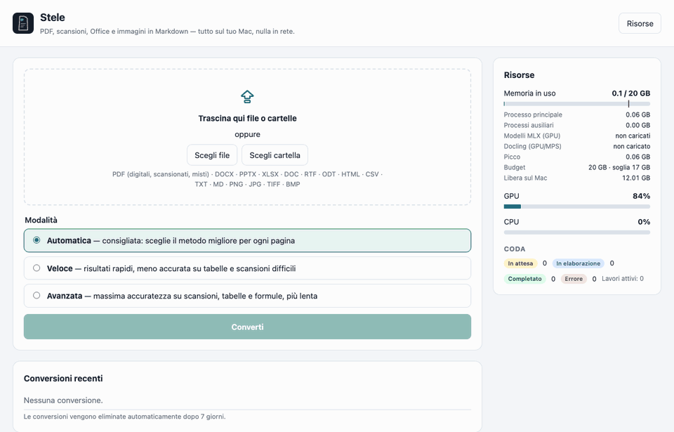
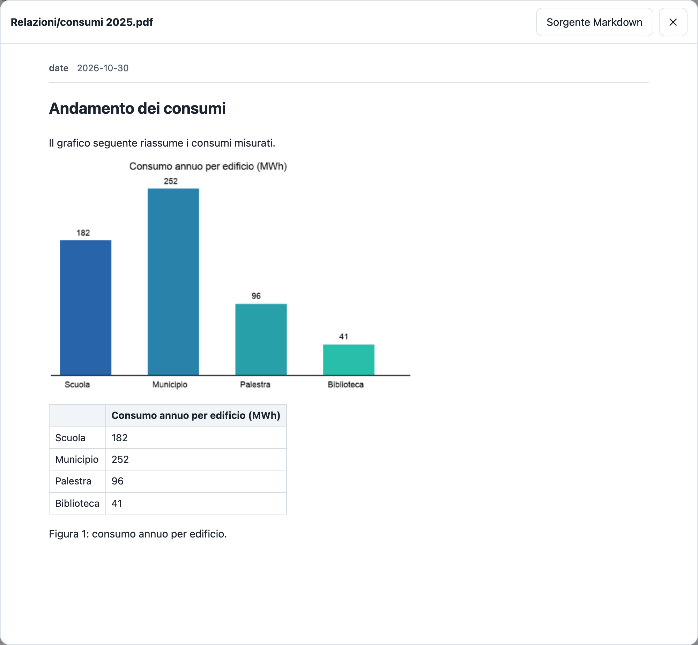
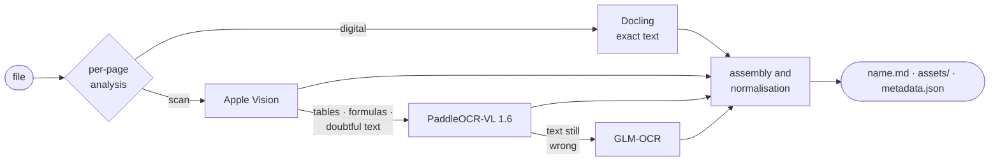

<p align="center">
  
</p>

<p align="center">
  <strong>English</strong> · <a href="README.it.md">Italiano</a>
</p>

<p align="center">
  <strong>PDFs, scans, Office files and images to clean Markdown.</strong><br>
  On Apple Silicon, fully offline.
</p>

<p align="center">
  <a href="https://github.com/Sero3105/stele/actions/workflows/ci.yml"></a>
  <a href="https://github.com/Sero3105/stele/releases/latest"></a>
  
  
  
  
</p>

**Stele** turns PDFs, scans, Office documents and images into one Markdown document per
file, with images, tables and metadata. The result is ready for Obsidian, VS Code or a RAG
pipeline.

Every page is read by the engine that suits it: exact text for digital PDFs, Apple Vision
for simple scans, vision-language models for tables, formulas and hard scans. No cloud and
no API: the server listens on `127.0.0.1` only, models are downloaded once and the app works
offline within a fixed memory budget.

<p align="center">
  
</p>
<p align="center"><em>A folder of PDFs, scans, slides and images: automatic mode, then the preview of the result.</em></p>

> The interface and the generated documents' notes are in Italian; the Markdown keeps the
> language of the source document.

## Contents

- [Features](#features)
- [Quick start](#quick-start)
- [Modes](#modes)
- [Output](#output)
- [Supported formats](#supported-formats)
- [How it works](#how-it-works)
- [Technical decisions](#technical-decisions)
- [Engines and models](#engines-and-models)
- [Memory and performance](#memory-and-performance)
- [Data, privacy and configuration](#data-privacy-and-configuration)
- [Development](#development)
- [Known limits](#known-limits)
- [Troubleshooting](#troubleshooting)

## Features

- **Per-page routing** — A mixed PDF (digital pages, scans and tables) uses different
  engines page by page and still comes back as one document, in order and without
  duplicates.
- **The big model only when needed** — A 12-page prose scan takes **6 s** in automatic mode
  against 33 s for a full read with the most accurate model, at the same quality.
- **Nothing made up** — Chart data is extracted only when every value is printed in the
  image. Metadata appears only if the file has it. The text is never rewritten.
- **Automatic resume** — Every finished page is saved right away: after a crash the
  conversion restarts from the first missing page. A failure on one file never stops the
  others.
- **Memory under control** — 20 GB default budget, respected even with 900 pages in parallel
  (measured peak: 7.7 GB).

## Quick start

**Requirements:** a Mac with Apple Silicon, [uv](https://docs.astral.sh/uv/) and the Xcode
Command Line Tools (`xcode-select --install`).

```bash
git clone https://github.com/Sero3105/stele.git && cd stele
make install   # Python 3.12 environment, pinned dependencies and the native Apple Vision helper
make models    # download and verify the models into ./models (~2.6 GB, the only online step)
make run       # start the server, then open http://127.0.0.1:8000
make app       # optional: Stele.app in the menu bar, no terminal needed
make quick-action  # optional: Finder → right click → Quick Actions → "Converti con Stele"
```

Drop files or folders onto the page, pick a mode and press **Converti** (Convert). When it
is done you can download the whole **ZIP**, or open the preview and download a single
document.

From the terminal, without the web app (same output layout as the ZIP):

```bash
.venv/bin/python -m app.convert folder/ file.pdf --out results/ --mode auto [--rag] [--split] [--pages 1-5]
```

The Finder Quick Action runs the same command on the selected files: results go to
`Markdown (Stele)` next to them, and nothing keeps running afterwards.

**Stele.app** is a menu bar icon: on launch it starts the server and opens the browser; its
menu opens the interface, the data folder or the log, and *Quit* stops the server. You can
drag it into Applications; if you move the project folder, run `make app` again.

<details>
<summary><strong>Note for Safari</strong></summary>

Safari unzips downloaded archives by itself: the folder may show up in Downloads instead of
the archive. To keep the `.zip`: Safari → Settings → General → turn off *Open "safe" files
after downloading*. To choose where to save every time: *File download location* → *Ask for
each download*.

</details>

## Modes

| Mode | Digital pages | Scanned pages and images | Best for |
|---|---|---|---|
| **Automatic** *(Automatica, default)* | Docling; PaddleOCR-VL reads display formulas as LaTeX | Apple Vision → PaddleOCR-VL for tables, formulas or doubtful text → GLM-OCR if the text is still wrong | General use |
| **Fast** *(Veloce)* | Docling | Apple Vision; Docling + OcrMac only if the page comes out empty. Never VLMs | Many simple documents |
| **Advanced** *(Avanzata)* | Docling; PaddleOCR-VL reads display formulas as LaTeX | PaddleOCR-VL on every page; GLM-OCR if the text is still wrong | Scans with many tables or formulas |

Benchmark on the same 31 test pages (synthetic dataset, MacBook Pro M4 Pro 24 GB):

| Mode | Time | Mean CER | Peak memory |
|---|---:|---:|---:|
| Fast | 20 s | 2.12% | 2.3 GB |
| **Automatic** | **45 s** | **0.15%** | 5.9 GB |
| Advanced | 70 s | 0.18% | 5.9 GB |

## Output

<p align="center">
  
</p>
<p align="center"><em>Document preview: the original chart and the data table read from the image.</em></p>

```text
conversione.zip
├── README.txt                  list of documents and any errors
├── relazione/
│   ├── relazione.md            one document per source file
│   ├── assets/grafico_001.png  images linked with relative paths
│   ├── assets/tabella_001.csv  every table also as CSV
│   ├── metadata.json           source, format, pages, mode, language, duration
│   └── chunks.jsonl            sections with their source pages (RAG option only)
└── archivio/scansione/…        uploaded folders keep their structure
```

- **Uniform Markdown** whatever the engine: headings without skipped levels, paragraphs and
  tables split across pages joined again, page numbers and repeated headers removed, lists,
  tables and `$$…$$` formulas in one form. Title, author and date become YAML front matter
  (Obsidian "properties") only if the file has them. Markdown sources are published as
  written: front matter, callouts and checkboxes stay as they are.
- **Tables** — On degraded scans the structure comes from PaddleOCR-VL and the text from
  GLM-OCR, without losing or adding numbers. When the rebuild is not reliable, readable rows
  replace an untrustworthy table.
- **Formulas** — Display formulas in digital PDFs are cropped from the page and read as
  LaTeX by PaddleOCR-VL; the text around them stays the exact PDF text layer.
- **RAG option** — `<!-- pagina N -->` where each page starts (invisible when rendered) and
  `chunks.jsonl`: one line per section with its heading path, text, source pages and the
  engines that read them, ready for a retrieval index without chunking again.
- **Charts** — The image is always kept; the data table appears only when every value is
  readable in the chart.
- **Office** — PPTX: one section per slide with the speaker notes. XLSX: one section per
  sheet, formulas with their computed values and merged cells in `metadata.json`.
- **Streaming ZIP** — The archive is built inside the HTTP response: no intermediate file on
  disk and nothing to clean up.

In the interface:

- **Pages to check** — The preview lists the pages whose text still looks doubtful or that
  were read a second time, with the reason; click one to see the original page next to the
  Markdown.
- **Original page side by side** — PDFs and images show the page image next to the converted
  text (aligned page by page with the RAG option).
- **Retry and reconvert** — Retry a failed file or reconvert a finished one in Advanced mode
  from the original upload, without uploading it again.
- **Already converted** — A file identical to one already converted with the same options
  (same SHA-256) gets a copy of that result instead of a new conversion.
- **Search** — Full-text search (SQLite FTS5, accents ignored) across every converted
  document; *Conserva* (Keep) excludes a conversion from the 7-day cleanup.
- **Correct by hand** — *Modifica* (Edit) opens the Markdown next to the original page; saving
  updates the search index, the table CSVs and the chunks. *Copia* copies the whole document.
- **Rate the result** — *Buono* (good) keeps it; *Così così* (so-so) re-reads the doubtful pages
  (all, if none is listed) with the next stronger engine, reusing the other pages from their
  checkpoints; *Da rifare* (to redo) reconverts in Advanced mode, or with GLM-OCR on every page
  if it already was Advanced. The replaced version is kept: *Confronta* (Compare) shows a line
  diff and lets you go back. A failed reconversion leaves the previous result in place.
- **Options** — *Dividi in capitoli* (split into chapters): one note per chapter in
  `capitoli/` plus an index note with `[[wiki-links]]`; *Solo alcune pagine* (only some
  pages): e.g. `1-5, 8`. Every document gets Obsidian/Synapse properties (`source`, `pages`,
  `language`, `converted`, `tags: [stele]`).
- **Notification** — When a conversion ends while the tab is in the background.

## Supported formats

| Category | Formats |
|---|---|
| PDF | Digital, scanned, mixed, multi-page, with tables, formulas, charts or two columns |
| Office | DOCX, PPTX, XLSX · DOC, RTF, ODT via macOS `textutil` |
| Text | HTML, CSV, TXT, Markdown (images linked next to the file are included) |
| Books and mail | EPUB without DRM (chapters in reading order, with pictures) · EML (header, body, attachments converted as separate documents) |
| Images | PNG, JPG, TIFF (multi-page too), BMP |

> PPT, XLS, ODP and ODS need LibreOffice (`brew install --cask libreoffice`).
> Without it, the app clearly reports the format as unavailable.

## How it works



A page is read again only if the quality check asks for it, at most once per engine. The
check looks at the text that came out — the macOS Italian/English dictionary, junk
characters and the repetition loops typical of VLMs — instead of trusting the engines'
self-reported "confidence".

Files are scheduled round-robin across uploads: a single file sent after a 25-file folder
starts at the next free worker instead of waiting for the whole folder.

## Technical decisions

Every choice was measured, not assumed: same machine (M4 Pro, 24 GB), same dataset. Method
and full tables in [benchmarks/REPORT.md](benchmarks/REPORT.md) (in Italian).

| Decision | Instead of | Measurement |
|---|---|---|
| Quality check on the produced text | Trusting engine confidence | Docling reported `ocr_score` 1.0 on a page with 20% wrong characters |
| Big model only on the pages that need it | A VLM on every page | 12-page prose scan: **6.0 s instead of 32.9 s** (5.5×), CER 0 in both cases |
| GLM-OCR on the page downscaled to 1024 px | Full resolution | **1.9 s/page instead of 13.4**, and the lowest CER of all engines on degraded scans (0.9–1.6%) |
| 4-bit MLX weights | Original models | CER within ±0.5 points, −1.1 GB (PaddleOCR-VL) and −0.9 GB (GLM-OCR), 20–40% faster |
| Budget on the kernel's *phys_footprint* | RSS | RSS doesn't see Metal/MLX buffers; this way 900 pages in parallel stay at 7.7 GB out of 20 |

## Engines and models

| Engine | Role | Runtime | Disk |
|---|---|---|---:|
| [Docling](https://github.com/docling-project/docling) 2.145 (Heron layout + TableFormer) | Digital PDFs, Office, HTML | torch / MPS | 505 MB |
| Apple Vision (`RecognizeDocumentsRequest`, Swift helper) | Simple scans | Neural Engine | system |
| OcrMac (Apple Vision via pyobjc) | Text inside images, within Docling | Neural Engine | system |
| [PaddleOCR-VL 1.6](https://huggingface.co/PaddlePaddle/PaddleOCR-VL-1.6) 4-bit + PP-DocLayoutV3 | Tables, formulas, complex layouts, charts | [MLX](https://github.com/ml-explore/mlx) / Metal | 936 MB |
| [GLM-OCR](https://huggingface.co/zai-org/GLM-OCR) 4-bit, page at 1024 px | Last resort for hard pages | MLX / Metal | 1196 MB |

The quantized versions were chosen after measuring them against the originals: same
quality, about 1 GB less and faster. All weights live in `models/` at pinned revisions.

```bash
.venv/bin/python -m app.models status           # installed models, sizes and integrity
.venv/bin/python -m app.models download [key]   # download the missing ones (checks free space first)
.venv/bin/python -m app.models prune [--yes]    # remove models that aren't needed (default: list only)
```

## Memory and performance

Each engine declares its measured cost and takes a *lease* before working. It starts only
if the real **phys_footprint** — which, unlike RSS, includes Metal/MLX buffers — plus the
job's cost stays under 85% of the budget and macOS has enough free memory; otherwise the job
waits in the queue. Idle models are unloaded to make room, and each engine keeps a single
set of weights: Docling serves up to 3 jobs from the same instance.

| Scenario (20 GB budget) | Time | Peak including child processes |
|---|---:|---:|
| 100-page PDF | 60 s | 6.2 GB |
| 500-page PDF | 277 s | 6.2 GB |
| 100 + 300 + 500 pages in parallel | 305 s | 7.7 GB |

The **Risorse** (Resources) panel shows the memory of the process and its children, MLX and
Docling usage, peak, budget, CPU and GPU (from the IOKit registry, no privileges needed).
Anything that can't be measured is shown as "Non disponibile" (not available), never
estimated.

## Data, privacy and configuration

Nothing is written to the project folder. Data lives in
`~/Library/Application Support/Stele` (or the folder set by `STELE_STORAGE`):

| Folder | Contents |
|---|---|
| `uploads/` | Uploaded original files |
| `work/` | Per-page checkpoints and internal reports (never in the ZIP) |
| `results/` | Final documents |
| `jobs.sqlite3` | Job state |

Every finished page is saved with an atomic write. Conversions older than 7 days are deleted
automatically, never while they are running or being downloaded, and never if kept.

| Variable | Default | Description |
|---|---|---|
| `STELE_MEMORY_BUDGET_GB` | `20` | Memory ceiling for the whole app |
| `STELE_WORKERS` | `4` | Files processed in parallel (upper bound; memory decides) |
| `STELE_PORT` | `8000` | Local server port |
| `STELE_STORAGE` | `~/Library/Application Support/Stele` | Data folder |
| `STELE_RETENTION_DAYS` | `7` | Days conversions are kept |

## Development

```text
app/
  main.py          FastAPI API and static frontend
  convert.py       command-line batch conversion (also used by the Finder Quick Action)
  jobs.py          jobs on SQLite, scheduler, resume, reuse, search index, cleanup
  pipeline.py      one file: analysis → routing → engines → quality → assembly → publishing
  router.py        routing policy (pure functions)
  markdown.py      page assembly and Markdown normalisation
  tables.py        table structure in the GLM fallback
  charts.py        chart data, only when verifiable
  checkpoint.py    per-page checkpoints, atomic writes, locks
  export.py        streaming ZIP
  resources.py     memory budget, leases, model residency
  models.py        model registry, download, verification and pruning
  engines/         Docling, Apple Vision, VLMs on MLX
native/            Swift helper for Apple Vision, menu bar app, Finder Quick Action
frontend/          HTML, CSS and JS with no external dependencies
benchmarks/        generated dataset, benchmarks, REPORT.md
tests/             235 tests: unit, router, Markdown, tables, charts, pipeline, API/ZIP,
                   kill -9 and resume, browser (Chrome and WebKit)
```

```bash
make test                                          # full suite
.venv/bin/python -m pytest tests/test_browser.py   # UI in Chrome and WebKit (Playwright)
make bench                                         # engine, model and scheduler benchmarks
```

CI runs the full suite, models included, on a GitHub-hosted Apple Silicon runner
(`macos-26`).

## Known limits

- Quality figures come from a **synthetic dataset** (generated and artificially degraded
  pages, in Italian and English): they compare engines and configurations, they don't
  guarantee quality on real documents.
- No data is extracted from charts without printed values, because the bars would have to
  be estimated.
- Inline formulas in digital PDFs stay as text; display formulas and formulas in scans
  become LaTeX.
- Heading levels depend on the engine that reads the page: the normaliser removes skipped
  levels but doesn't promote headings.
- For DOCX, PPTX and XLSX, resume after a crash works per file, not per page.
- The interface is tested on Chrome and WebKit (Safari's engine), not on the Safari app.

## Troubleshooting

| Problem | Fix |
|---|---|
| Warning "alcuni modelli non sono installati" (some models are missing) | `make models`, or `make -C native` for the Apple Vision helper |
| "Il formato .xls richiede LibreOffice" | `brew install --cask libreoffice`, then restart the app |
| Queued conversions don't start | Memory is taken by other apps: the queue restarts by itself |
| "Spazio su disco insufficiente" (not enough disk space) | At least 2 GB free is needed; delete old conversions |
| Port already in use | `STELE_PORT=8010 make run` |
| Browser tests skipped | `.venv/bin/playwright install webkit` (system Chrome is used directly) |

## Acknowledgements

Stele builds on [Docling](https://github.com/docling-project/docling),
[PaddleOCR-VL](https://github.com/PaddlePaddle/PaddleOCR),
[GLM-OCR](https://huggingface.co/zai-org/GLM-OCR), [MLX](https://github.com/ml-explore/mlx),
[mlx-vlm](https://github.com/Blaizzy/mlx-vlm) and Apple's Vision framework.
Models keep their own licences (Apache-2.0 and MIT).
